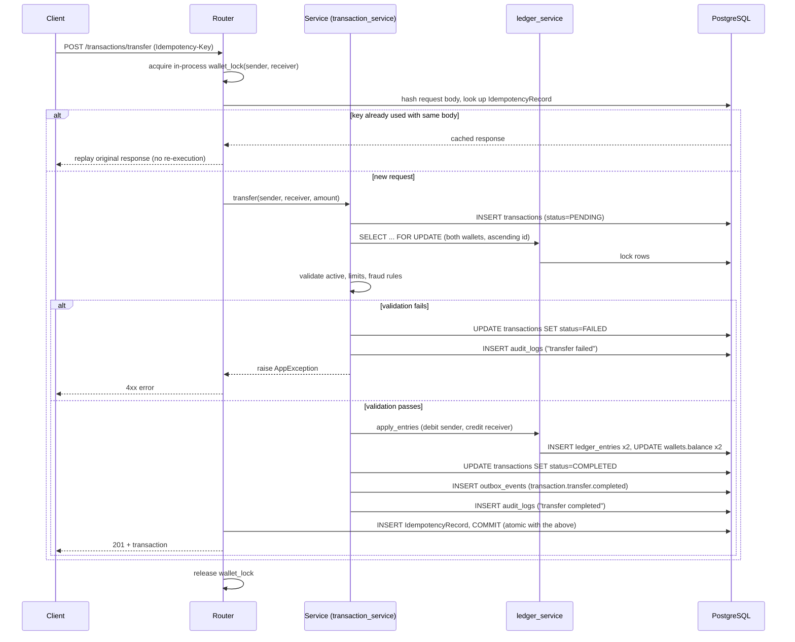

# Digital Wallet & Financial Transaction System — Architecture Plan

Project 1 of 3. Status: **Steps 1–15 complete.** Backend, admin dashboard, reliability/concurrency
hardening, seed data, and deployment readiness are all in place. See section 15 for what changed
in the hardening pass and section 16 for what's still a known, documented limitation.

## 1. Overview

A production-style digital wallet platform: users hold one or more wallets, deposit/withdraw
simulated funds, transfer to other users, request payments, and receive refunds. The system's
priority order is **correctness > security > features**. Every balance change must be provable
from an immutable ledger, never lost, never duplicated, and safe under concurrent access.

## 2. Main Entities

| Entity | Purpose |
|---|---|
| `User` | Account holder. Roles: `user`, `support`, `admin`. |
| `LoginEvent` | Login attempts / security events per user (IP, user agent, success/failure). |
| `Wallet` | Belongs to a user. One currency each (a user can hold several wallets, one per currency). Status: `active`, `frozen`, `closed`. Carries a **cached** `balance` / `available_balance` for fast reads — never the source of truth. |
| `LedgerEntry` | Immutable debit/credit row against a wallet, linked to a transaction. Source of truth for balances. |
| `Transaction` | A financial operation: `deposit`, `withdrawal`, `transfer`, `payment_request`, `refund`, `reversal`. Has status, amount, currency, idempotency key, timestamps. |
| `PaymentRequest` | A request from one wallet to another for payment; on acceptance produces a `transfer` transaction. |
| `IdempotencyRecord` | `(user_id, idempotency_key, endpoint)` → cached response, so retried requests replay the original result instead of re-executing. Scoped per user — see section 12. |
| `TransferLimitPolicy` | Configurable per-role or per-user limits: max transaction amount, daily transfer/withdrawal caps. |
| `FraudRule` | Configurable rule (type + JSON config + action: `allow`/`review`/`block`). |
| `FraudEvent` | Result of evaluating rules against a transaction: risk score, triggered rules, action taken. |
| `AuditLog` | Insert-only record of every sensitive action (who, what, before/after, when). Never updated or deleted. |
| `OutboxEvent` | Transactional outbox row written **in the same DB transaction** as the financial change; a separate worker publishes it asynchronously. This is how notifications stay outside the financial transaction. |

## 3. Database Schema (proposal)

```
users(id, email UNIQUE, username UNIQUE, password_hash, full_name, role, is_active, created_at, updated_at)
login_events(id, user_id FK, event_type, ip_address, user_agent, success, created_at)

wallets(id, user_id FK, currency, status, balance, available_balance, version, created_at, updated_at)
  -- `version` = optimistic-lock counter, bumped on every ledger-affecting write
  -- UNIQUE(user_id, currency); CHECK(balance >= 0); CHECK(available_balance >= 0)

ledger_entries(id, wallet_id FK, transaction_id FK, entry_type[debit|credit], amount, currency,
                balance_after, created_at)
  -- append-only; balance can be rebuilt by summing entries per wallet
  -- CHECK(amount > 0); CHECK(balance_after >= 0)

transactions(id, type, status, sender_wallet_id FK NULL, receiver_wallet_id FK NULL,
             amount, currency, description, reference, metadata JSON,
             idempotency_key, created_at, completed_at)
  -- CHECK(amount > 0); INDEX(sender_wallet_id, created_at); INDEX(receiver_wallet_id, created_at)

payment_requests(id, requester_wallet_id FK, payer_wallet_id FK, amount, currency, status,
                  transaction_id FK NULL, created_at, expires_at)
  -- CHECK(amount > 0)

idempotency_records(id, user_id FK, idempotency_key, endpoint, request_hash, status_code,
                     response_body JSON, created_at)
  -- UNIQUE(user_id, idempotency_key, endpoint) — see section 12 for why user_id is part of the key

transfer_limit_policies(id, scope[global|role|user], scope_ref, max_transaction_amount,
                         daily_transfer_limit, daily_withdrawal_limit, is_active)
  -- UNIQUE(scope, scope_ref); CHECK(each limit > 0)

fraud_rules(id, name, rule_type, config JSON, action, is_active, created_at)
fraud_events(id, transaction_id FK, rule_id FK, risk_score, action, details JSON, created_at)

audit_logs(id, actor_user_id FK NULL, action, entity_type, entity_id, before JSON, after JSON,
           ip_address, created_at)
  -- insert-only, no update/delete path exposed anywhere in the app

outbox_events(id, event_type, payload JSON, status[pending|published|failed], attempts,
              created_at, published_at)
```

Indexing choices worth calling out: every wallet lookup by user is covered by
`UNIQUE(user_id, currency)`; transaction history queries filter by wallet + time range, so both
`sender_wallet_id` and `receiver_wallet_id` get `(wallet_id, created_at DESC)` composite indexes;
`idempotency_records` is looked up by `(user_id, idempotency_key, endpoint)` on every write
request, so that triple is the unique constraint *and* the index.

## 4. API Modules

| Module | Endpoints |
|---|---|
| `auth` | register, login, refresh, me, logout |
| `users` | list/get (support+), activate/deactivate (admin) |
| `wallets` | create, get, list mine, search (support+, all users), admin freeze/unfreeze |
| `transactions` | deposit, withdraw, transfer, refund, reverse, list/search (filters: status, type, wallet, date range) |
| `payment-requests` | create, accept, decline, cancel, list |
| `fraud` | list fraud events (admin/support), CRUD fraud rules (admin) |
| `audit` | search audit log (admin) |
| `admin/stats` | aggregate financial statistics for the dashboard |
| `health` | `/health` (combined liveness+readiness, used by Docker `HEALTHCHECK`), `/api/v1/health` (liveness), `/api/v1/health/ready` (readiness, checks Postgres) |

## 5. Backend Folder Structure

```
app/
  core/        config, database, security (hash/JWT), exceptions, middleware, logging
  models/      user, wallet, ledger, transaction, payment_request, fraud, audit, outbox, idempotency
  schemas/     pydantic request/response models per module
  repositories/  thin persistence layer (query building) — keeps services free of raw SQLAlchemy
  services/    auth, wallet, ledger, transaction (the transfer/deposit/withdraw engine),
               fraud, audit, idempotency, outbox_dispatcher
  api/v1/      routers — translate HTTP only, no business rules
workers/       outbox_worker.py — polls outbox_events, dispatches to notification channel
alembic/       migrations
scripts/       seed.py — development demo data, run through the service layer (see section 15)
tests/         unit + integration + concurrency tests + ledger_assertions.py (shared invariants)
frontend/      React + TS + Vite admin dashboard
```

Request flow: `Router → Service → Repository/Ledger → PostgreSQL`. All business rules (limits,
fraud checks, permission checks) live in `services/`, never in routers.

## 6. Infrastructure Components

- **PostgreSQL** — system of record. Required for real row-level locking (`SELECT ... FOR UPDATE`);
  SQLite is used only for fast unit tests that don't exercise concurrency.
- **Redis** — provisioned in Docker Compose and configured via `REDIS_URL`, for a stated future
  need: shared rate-limit counters across multiple API instances. **Not yet wired into any code
  path** — today's rate limiter is a single-process in-memory sliding window (section 10), which is
  correct for this single-instance deployment but would need Redis the moment there's more than
  one API replica. Listed here as declared infrastructure with a documented gap, not as something
  already in use, to avoid overclaiming.
- **Outbox + worker** (this project) instead of a full broker: financial writes insert an
  `outbox_events` row in the *same transaction* as the ledger update; a separate worker process
  polls and dispatches. This satisfies "don't notify inside the financial transaction" without
  standing up RabbitMQ twice — **Project 2 (Distributed Notification Platform) is exactly the
  system this outbox will eventually hand events to.** Building a second message broker here
  would duplicate that project's purpose, so the decision is: outbox now, real broker integration
  later as an adapter swap.
- **Docker Compose** — postgres, redis, api, worker (frontend built into the api image via the
  Dockerfile's multi-stage build; see the README's Docker section).

## 7. Transaction Flow

Every money-moving endpoint follows the same shape end to end:



The commit that finalizes the transaction and the commit that stores the idempotency record are
the *same* `db.commit()` call (`idempotency_service.commit_atomically`) — see section 12.

## 8. Concurrency Strategy

Wallet-affecting operations (deposit, withdraw, transfer, refund, reversal, payment-request accept)
run inside one DB transaction that:

1. Locks every wallet row involved with `SELECT ... FOR UPDATE`, **always in ascending wallet-id
   order**, to prevent deadlocks between two transfers that touch the same two wallets in opposite
   directions.
2. Re-reads the locked balance, validates funds/limits/fraud rules against that fresh value.
3. Writes the ledger entries + updates the cached balance + bumps `version`.
4. Commits — releasing the locks.

This is pessimistic locking (`SELECT FOR UPDATE`), chosen over optimistic locking because
financial transfers are short, contended, and must never be retried silently from the user's
perspective — a lost-update retry loop on money movement is worse than a brief lock wait.
`version` is still kept on `wallets` for optimistic checks on non-critical reads (e.g. admin
freeze/unfreeze racing with a transfer).

Two locking layers work together, not just one:

- **`ledger_service.wallet_lock`** — an in-process `threading.Lock` per wallet id, held for the
  *entire* read-modify-write-commit sequence (acquired in the router, before the service is even
  called — see `api/v1/transactions.py::_idempotent`). This is what makes the test suite's SQLite
  concurrency tests meaningful despite SQLite silently ignoring `FOR UPDATE`, and it adds a cheap
  extra guard even under Postgres within a single process.
- **`ledger_service.lock_wallets`** (`SELECT ... FOR UPDATE`) — what actually protects correctness
  across multiple worker processes talking to the same PostgreSQL database in production.

**Refund and reversal close a second race the wallet lock alone doesn't cover.** Both start from a
`Transaction` object the router fetched *before* acquiring the wallet lock. Under multiple worker
processes, two concurrent `reverse()` calls for the *same* transaction could both observe
`status == COMPLETED` from their own pre-lock reads before either commits — a double reversal. Once
the wallet lock is held, `ledger_service.lock_transaction()` re-fetches that row under
`SELECT ... FOR UPDATE` with `populate_existing=True` (the same idiom `lock_wallets` uses, for the
same reason: SQLAlchemy's identity map would otherwise silently hand back the stale, already-loaded
Python object instead of the freshly-locked row) and re-checks `status` against that fresh read.
The second caller then sees the already-REVERSED status and rejects cleanly instead of re-applying.
`payment_request_service.accept()` closes the identical race for payment requests the same way, by
locking the `PaymentRequest` row itself before re-checking `status == PENDING`.
See `tests/test_concurrency.py`'s reversal and payment-request tests for the regression coverage.

## 9. Money Representation & Ledger Model

**All monetary values are `Decimal`, quantized to 2 places at the database layer
(`NUMERIC(18, 2)`), end to end** — SQLAlchemy models, Pydantic schemas, service-layer arithmetic,
and JSON responses (Pydantic v2 serializes `Decimal` to a **string**, e.g. `"100.00"`, never a
binary-float JSON number — confirmed by inspecting the actual response bytes, not assumed). The
one deliberate exception is values that are display-only aggregates with no further arithmetic
performed on them (`admin/stats`'s `completed_transaction_volume`, `FraudEvent.details["amount"]`
in its JSON blob) — those are cast to `float` explicitly at the point of construction, with a
comment explaining why it's safe there. Request schemas reject (never silently round) any amount
with more than 2 decimal places via Pydantic's `decimal_places=2` constraint — a client sending
`10.123` gets a 422, not a silently-truncated `10.12`.

Frontend TypeScript treats money fields as an opaque `Money = string` type (see
`frontend/src/api/types.ts`) and only converts to `Number` at the point of display formatting
(`formatMoney`), never for further calculation — the backend is the only source of truth for any
arithmetic on money.

**Deposits and withdrawals are intentionally single-sided ledger entries**, not classic
double-entry pairs: a deposit writes one `CREDIT` entry to the receiving wallet, a withdrawal
writes one `DEBIT`, and neither has an offsetting entry anywhere, because this system models them
as money crossing a simulated external boundary (a bank/card network) that isn't itself a wallet in
the ledger. Only **internal** movements — transfer, refund, reversal — are truly double-entry (one
debit + one matching credit, always summing to zero for that transaction). This is why
`tests/ledger_assertions.py` provides `assert_transaction_is_balanced` / `assert_internal_transfers_balanced`
scoped to those three types, rather than a single global "all debits equal all credits" invariant —
the latter would be actively wrong for a system with deposits/withdrawals in it. What *is* checked
globally, for every wallet, is `assert_wallet_matches_ledger`: the cached `wallets.balance` must
always equal the sum of that wallet's own ledger entries.

## 10. Security Strategy

- JWT access (short-lived) + refresh tokens, bcrypt password hashing.
- RBAC enforced in the service layer (`user` / `support` / `admin`), never trusted from the client.
- Idempotency-Key required on all money-moving POST endpoints, scoped per user (section 12).
- Rate limiting (in-memory, documented as needing to move to Redis for a multi-instance deployment)
  per client IP on all endpoints except health checks and docs.
- Every sensitive action writes an `audit_logs` row — append-only, no delete/update endpoint ever
  exposed for it — including *failed* transaction attempts (insufficient funds, frozen wallet,
  fraud block), not just successful ones.
- Secrets only via environment variables; `.env` never committed (`.gitignore`/`.dockerignore`
  both exclude it; `git status` confirms it was never staged).
- **Known gap, deliberately not fixed here**: refresh tokens are not rotated or revocable — a
  stolen refresh token remains valid until it naturally expires (`REFRESH_TOKEN_EXPIRE_DAYS`).
  Fixing this properly needs a token denylist (Redis is already in the stack for this reason) and
  is scoped as follow-up work rather than squeezed into this hardening pass, since it's a genuine
  new feature (a revocation store), not a correctness bug in existing code.

## 11. Fraud Evaluation

`fraud_service.evaluate()` runs every active `FraudRule` against a transaction attempt. Each rule's
`rule_type` maps to an evaluator function (`_EVALUATORS` dict) — **the mapping is a fixed,
closed set**: `large_amount`, `transfer_velocity`, `new_recipient_large_amount`. A rule created with
any other `rule_type` string is silently never evaluated (`evaluate()` skips unknown types rather
than erroring), which is why the admin dashboard's "create rule" form uses a fixed dropdown driven
by that same list instead of a free-text field — a typo'd rule_type from a free-text input would
look successfully created but never actually fire. The highest-severity outcome across all
triggered rules wins (`BLOCK` > `REVIEW` > `ALLOW`); every triggered rule still writes a
`FraudEvent` row (even for `ALLOW`, though `ALLOW` never blocks or reviews), so the fraud dashboard
shows what was evaluated, not just what acted.

## 12. Idempotency Semantics

Every money-moving endpoint (`deposit`, `withdraw`, `transfer`, `refund`, `reverse`) requires an
`Idempotency-Key` header. The exact contract, enforced by `idempotency_service` +
`api/v1/transactions.py::_idempotent`:

- **Same user + same key + same endpoint + same request body** → the second (and every
  subsequent) call replays the first call's stored `(status_code, response_body)` without
  re-executing anything. Verified by `test_deposit_is_idempotent` and
  `test_transfer_produces_exactly_two_ledger_entries`.
- **Same user + same key + same endpoint + a *different* request body** → `409 Conflict`
  (`IdempotencyConflictError`). A reused key is a client bug (or key collision), not something to
  silently execute against different parameters.
- **Same key used concurrently, twice, before either has committed** → the in-process
  `wallet_lock` fully serializes the two attempts within one process (the second literally cannot
  proceed until the first's lock is released, post-commit); across multiple processes, the
  `UNIQUE(user_id, idempotency_key, endpoint)` constraint on `idempotency_records` makes only one
  `INSERT` win — the loser's `commit_atomically()` catches the resulting `IntegrityError` and
  converts it to the same clean `409` a body mismatch would give, instead of a raw DB error leaking
  out. See `idempotency_service.commit_atomically`'s docstring.
- **Scoped per user, not just per (key, endpoint)**: `IdempotencyRecord` includes `user_id` in its
  unique constraint. Without this, user A submitting a request with the same `Idempotency-Key`
  string user B happens to be using on the same endpoint could either get a spurious 409 or, if the
  two request bodies happened to hash identically, silently receive B's cached response — a
  cross-user data leak. `test_idempotency_key_is_scoped_per_user` is the regression test.
- **Payment-request `accept`/`decline`/`cancel` are idempotent-safe by construction, not by key**:
  these endpoints don't take an `Idempotency-Key` at all. Safety instead comes from the state
  machine (`PENDING → ACCEPTED/DECLINED/CANCELLED` is one-way) combined with locking the
  `PaymentRequest` row before re-checking `status == PENDING` (section 8) — a retried `accept`
  after the first succeeded gets a clean `409`, never a second transfer. This is a deliberate
  alternative to key-based idempotency for this endpoint, not an oversight.
- **A failed attempt does not poison future retries with a different, valid request**: idempotency
  records are keyed by the request body's hash, so a client that fixes its request (e.g. corrects
  the amount) after a failed attempt and retries with the *same* key but a *corrected* body gets a
  `409` (by design — see the "different body" bullet above) prompting it to pick a new key, rather
  than the failed attempt silently blocking all future use of that key indefinitely.

## 13. Outbox Reliability

`workers/outbox_worker.py` polls `outbox_events` for `PENDING` rows and dispatches them (currently:
logs; swapping in a real notification call is an adapter change, not a redesign — see section 6).
Reliability properties, and how each is achieved:

- **Events are persisted atomically with the business transaction**: `outbox_service.enqueue()`
  is always called with the *same* `db` session that commits the ledger write, inside the same
  `db.commit()` — there is no window where a transfer commits but its notification event doesn't
  exist, or vice versa.
- **Each event commits independently within a batch**: `drain_once()` commits after every event,
  not once at the end of the whole poll. If the worker process crashes mid-batch, events already
  dispatched before the crash stay `PUBLISHED`; they are not rolled back and redelivered. Verified
  by `test_drain_once_commits_each_event_independently`, which simulates a crash on the second
  event of a batch and confirms the first stays durably published.
- **Failed dispatch retries, with a cap**: a dispatch failure leaves the event `PENDING` (so the
  next poll retries it) until `attempts >= OUTBOX_MAX_ATTEMPTS`, at which point it's marked
  `FAILED` and stops being retried.
- **Safe for multiple worker replicas**: `drain_once()` selects with
  `SELECT ... FOR UPDATE SKIP LOCKED`. Two workers polling at the same instant partition the queue
  — each skips rows the other already has locked — rather than both dispatching the same event or
  one blocking behind the other's lock. `docker-compose.yml` runs a single `worker` replica today,
  so this isn't exercised by the current deployment, but the query is written to be correct if that
  changes (`SKIP LOCKED` is a Postgres feature; it degrades to a plain `SELECT` on SQLite, which
  every test in this suite runs single-threaded against anyway).

## 14. Testing Strategy

- **Unit/integration tests** (SQLite, `tests/conftest.py`): the bulk of the suite — full HTTP flows
  via `TestClient`, run against an in-memory SQLite database for speed. Fast, but SQLite silently
  ignores `SELECT ... FOR UPDATE` and the test harness shares one connection, so these alone cannot
  prove the Postgres-specific locking strategy is what's doing the work (see section 8's two-layer
  locking explanation) — they prove the required *outcome* (no double-spend), not the *mechanism*.
- **Reusable ledger-integrity assertions** (`tests/ledger_assertions.py`): `assert_wallet_matches_ledger`,
  `assert_transaction_is_balanced`, `assert_internal_transfers_balanced`, `assert_no_orphan_ledger_entries`,
  `assert_transaction_ledger_entry_count` — shared invariant checks used across the concurrency,
  ledger-integrity, and payment-request test files rather than reimplemented per test.
- **Concurrency tests, two tiers**:
  - `tests/test_concurrency.py` — SQLite-backed, using real Python threads (`ThreadPoolExecutor`)
    against the shared `TestClient`, asserting the required outcome for double-spend (withdrawal
    and transfer) and double-reversal scenarios.
  - `tests/test_postgres_concurrency.py` — the same class of scenario (plus double-accept on
    payment requests) against a *real* multi-connection PostgreSQL pool, gated behind
    `POSTGRES_TEST_DATABASE_URL`. Not runnable in this sandboxed development environment (no
    Docker/Postgres here); runs in CI against a `postgres:16-alpine` service container on every
    push (`.github/workflows/ci.yml`'s `postgres-concurrency` job).
- **Idempotency tests**: same-key-same-body replay, same-key-different-body conflict, and
  cross-user key isolation (`test_idempotency_key_is_scoped_per_user`) — see section 12.
- **Outbox tests**: pending → published transition, per-event commit durability under a simulated
  mid-batch crash.
- **Security-relevant regression tests**: cross-user idempotency isolation, wallet-ownership checks
  (`test_cannot_see_others_wallet`, `test_cannot_transfer_from_someone_elses_wallet`), RBAC boundary
  checks on every staff-only endpoint (`test_*_requires_admin`/`test_*_requires_staff`).

Current state: 66 tests (3 of them Postgres-gated and skipped outside CI), 91% backend line
coverage. Coverage is not chased to 100% — the uncovered lines are concentrated in defensive
branches (e.g. a `NotFoundError` for a wallet id that can't actually go missing given the FK
constraints already in place) rather than untested business logic; every financial code path,
every authorization boundary, and every concurrency-sensitive branch has direct test coverage.

## 15. Step 14–15 Hardening Pass — What Changed

This section records the reliability/security review performed after the dashboard (step 13) was
complete, since several of these were genuine bugs, not just missing tests:

- **Fixed**: refund/reversal double-execution race under multi-process concurrency (section 8).
- **Fixed**: payment-request double-accept race under multi-process concurrency (section 8).
- **Fixed**: idempotency records were not scoped per user — a cross-user key collision could leak
  a cached response or cause a spurious conflict (section 12). Required an `IdempotencyRecord`
  schema change (`user_id` column, new unique constraint) — see the `initial schema` Alembic
  migration.
- **Fixed**: money was represented as Python `float` throughout (`Numeric(..., asdecimal=False)`),
  which is unsafe for financial arithmetic despite the DB column already being fixed-point. Moved
  to `Decimal` end to end (section 9). No DB migration needed for this specific change — the column
  type (`NUMERIC(18,2)`) was already correct; only the Python-side type changed.
- **Fixed**: a validation failure partway through `deposit`/`withdraw`/`transfer` (insufficient
  funds, frozen wallet, limit exceeded) previously rolled back the *entire* attempt, including the
  `Transaction` row itself — leaving zero audit trail that the attempt ever happened, unlike a
  fraud `BLOCK` (which already committed a `FAILED` row). All three now route every `AppException`
  through the same `_fail_and_commit` path fraud blocks used, so every failed attempt is now a
  `FAILED` transaction with an audit log entry.
- **Fixed**: the outbox worker had no multi-worker-safe claiming strategy and committed once per
  batch instead of once per event (section 13).
- **Fixed**: the admin dashboard's "create fraud rule" form offered `rule_type` values
  (`large_transaction`, `velocity`, `new_recipient`, `daily_limit_exceeded`) that didn't match any
  key `fraud_service._EVALUATORS` actually checks — a rule created through the dashboard would have
  looked successful but silently never fired (section 11).
- **Added**: `CHECK` constraints the application already enforced in code but the database didn't
  (`balance >= 0`, `amount > 0` on every monetary column, positive limit policies) — defense in
  depth against a future code path that forgets the application-level check.
- **Added**: the initial Alembic migration itself. There was no migration capturing the schema at
  all before this pass — `docker compose up`'s `alembic upgrade head` step would have run against
  an empty database with no tables, a deployment-blocking gap caught while reviewing "Docker
  Production Readiness."
- **Added**: `GET /api/v1/health` (liveness) and `GET /api/v1/health/ready` (Postgres check,
  `503` on failure) alongside the existing unversioned `/health` (kept for the Dockerfile's
  `HEALTHCHECK`, which targets it directly).
- **Added**: real-PostgreSQL concurrency tests (`tests/test_postgres_concurrency.py`), gated behind
  `POSTGRES_TEST_DATABASE_URL` and run in CI against a `postgres:16-alpine` service container —
  this sandboxed development environment has no Docker available, so these could not be executed
  locally; they are verified by CI on every push instead (see section 14 for what "verified" means
  here specifically).
- **Added**: `scripts/seed.py` + `make seed` / `make reset-db`, and this repository's first git
  history (`git init` + initial commit, done in the same working session as step 13, before this
  hardening pass began).

## 16. Development Roadmap

1. ✅ Project scaffolding — repo layout, config, DB/session setup, Alembic, Docker, CI, health check.
2. ✅ Auth & users — register/login/refresh, RBAC, login history.
3. ✅ Wallets — creation, status, currency handling.
4. ✅ Ledger core — double-entry ledger service, balance rebuild/verification.
5. ✅ Deposit & withdrawal — simplest ledger-writing flows, proves the locking pattern.
6. ✅ Wallet-to-wallet transfer — full concurrency control + idempotency.
7. ✅ Transfer limits — daily/max caps, configurable policies.
8. ✅ Refunds & reversals.
9. ✅ Fraud/risk rules engine + fraud review data.
10. ✅ Audit logging (cross-cutting, wired into services from step 2 onward, hardened in step 14).
11. ✅ Outbox + async notification dispatch (deposit/transfer/withdrawal/suspicious events).
12. ✅ Admin APIs — user/wallet management, transaction explorer, fraud alerts, audit viewer, stats.
13. ✅ Frontend admin dashboard (React + TS + Vite).
14. ✅ Reliability, concurrency, ledger-integrity, and test hardening — see section 15.
15. ✅ Seed data, deployment readiness, documentation, final verification — see section 15 and
    the README's setup/testing sections.

**Known, deliberately deferred limitations** (not fixed in this pass — each is either a new
feature rather than a bug, or explicitly out of scope):

- No refresh-token revocation/rotation (section 10).
- No admin API to create/manage `TransferLimitPolicy` rows — the model and resolution logic exist
  and are covered by tests, but only `settings.DEFAULT_*` values are reachable through the API
  today. Building the CRUD surface for it was judged a new feature, not a hardening fix.
- `admin/stats`'s `completed_transaction_volume` is a plain aggregate `float`, not `Decimal` — a
  deliberate, narrow exception for a display-only statistic with no further arithmetic performed
  on it (see section 9).
- The real-Postgres concurrency test suite (`tests/test_postgres_concurrency.py`) has not been run
  in this development environment (no Docker/Postgres available here) — it runs in CI against a
  real `postgres:16-alpine` service container instead. Treat "passes in CI" and "verified locally"
  as distinct claims; this project only claims the former for that specific test file.

Project 1 is now considered feature-complete and hardened for its stated scope. Project 2
(Distributed Notification Platform) begins only once explicitly requested.
